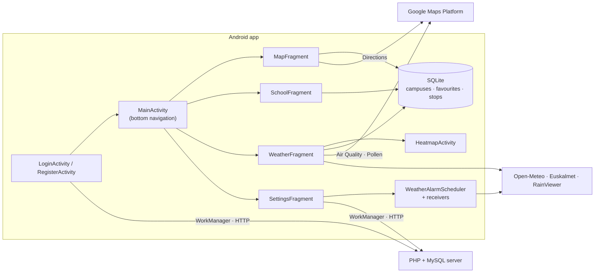

# UNIGO — Smart Urban Mobility for University Students (Android, Java)

A native Android app that helps university students in Bilbao and Bizkaia get to their campus. It plans walking, cycling and public-transport routes to 28 campuses, estimates the CO₂ saved compared with a car, shows the stops of 7 transport networks and the bike lanes, and adds weather, air-quality and pollen information. Available in 6 languages.

---

## Main features

| Tab | What it does |
|---|---|
| **Map** | Search for one of the 28 campuses (UPV/EHU, Mondragon Unibertsitatea, University of Deusto) and get a route on foot, by bike or by public transport (Google Directions API). Public-transport routes can be filtered by bus, metro, tram and train and by departure date and time. The route card shows each step (line, colour, stops, times), the fare when Google returns one, and the **CO₂ saved**. Separate layers show the **3,895 stops** of Bilbobus, Bizkaibus, Metro Bilbao, Euskotren, Renfe, Tram and Bilbaobizi, and the city's **bike lanes** (1,571 segments, KML). |
| **Campuses** | List with logos, areas and photos; filter by university; text search; favourites (per user) that move to the top; one tap opens the route on the map. |
| **Weather** | Current weather, max UV and sunrise/sunset (Open-Meteo); the official Euskalmet forecast for Greater Bilbao, translated on the device with ML Kit when the app is not in Spanish or Basque; air quality and pollen (Google APIs) with heat maps; live rain radar (RainViewer); temperature at each favourite campus. |
| **Settings** | Account (log in, register, guest mode, profile photo, password change), language, dark mode, favourite transport, electric-car option, map style, and a daily weather notification at a chosen time. |

Settings are saved **per user**, so several people can share a phone and keep their own theme, language and preferences.

---

## Technical highlights

- **Data integration.** The app combines 8 external services: the app's own PHP/MySQL back end, Google Directions, Air Quality and Pollen, Open-Meteo, Euskalmet Open Data (XML), RainViewer and on-device ML Kit translation. It also uses open data on stops from 7 networks.
- **Route post-processing.** The app requests all the alternatives from Google Directions. It decodes the encoded polylines with its own decoder, discards routes that use a transport mode the user excluded (Google sometimes returns them anyway), and keeps the first valid one. It then draws each step: walking steps as dotted lines, transit steps in the line's own colour, corrected when the colour is too light for the background.
- **CO₂ estimate.** Bus steps count 80 g/km and other transit 40 g/km. The car comparison uses the straight-line distance × 1.3 × 143 g/km, or 0 for an electric car. The card shows the saving.
- **Local persistence.** SQLite holds the campuses, favourites and stops. The 3,895 stops are loaded from JSON in a single background transaction. Campus names are refreshed from the localised resources on every start, so they follow the selected language.
- **Background work.**
  - WorkManager `Worker` for the server calls, observed with LiveData.
  - A background executor for the Directions calls.
  - Volley for the REST APIs.
  - `AlarmManager` exact alarms and a `BroadcastReceiver` for the daily notification, rescheduled every day and after a phone restart.
- **Android platform features.**
  - Runtime permissions: location and notifications.
  - Edge-to-edge layout with window insets.
  - Per-app language with `AppCompatDelegate.setApplicationLocales()`.
  - Light/dark themes and a `PreferenceFragmentCompat` with a custom preference.
  - Google Maps tile overlays (heat maps) and KML layers.
- **Localisation.** 6 languages (Spanish, Basque, English, French, German, Italian) with 267 strings each.

### Architecture



Screens, data model, sequence diagrams and the server API are described in [docs/DESIGN.md](docs/DESIGN.md).

### Representative code: filtering the Google route alternatives

From [`MapFragment.fetchGoogleRoute()`](app/src/main/java/com/example/unigo_das/fragments/MapFragment.java) (lines 715–733):

```java
String vType = lineData.has("vehicle") && lineData.getJSONObject("vehicle").has("type") ? lineData.getJSONObject("vehicle").getString("type") : "";

// Extra safety check, because Google sometimes returns bus routes even when they are excluded.
if (vType.contains("BUS") && !useBus) routeMatchesFilters = false;
else if (vType.contains("SUBWAY") && !useMetro) routeMatchesFilters = false;
else if (vType.contains("TRAM") && !useTram) routeMatchesFilters = false;
else if ((vType.contains("TRAIN") || vType.contains("RAIL")) && !useTrain) routeMatchesFilters = false;

// Estimated carbon footprint depending on the transport mode
int stepCo2 = 0;
if (vType.contains("BUS")) {
    stepCo2 = (int)(stepKm * 80);
    segment.colorCO2 = Color.parseColor("#1976D2");
} else {
    stepCo2 = (int)(stepKm * 40);
    segment.colorCO2 = Color.parseColor("#00897B");
}
segment.co2Info = stepCo2 + "g CO2";
tempRouteCo2 += stepCo2;
```

---

## How to build and run

**Requirements:**
- A recent Android Studio that supports Android Gradle Plugin 9 (it includes the JDK).
- Android SDK 36.
- A device or emulator with Google Play services, running Android 7.0 (API 24) or later.

1. Clone the repository and open it in Android Studio:
   ```bash
   git clone https://github.com/Ando144/Unigo-SmartMobility-App.git
   ```
2. Create your API keys file from the template:
   ```bash
   cp secrets.defaults.properties secrets.properties
   ```
   Then put your Google Cloud keys in `secrets.properties`:
   - `MAPS_API_KEY`: Maps SDK for Android.
   - `DIRECTIONS_API_KEY`: Directions API, Air Quality API and Pollen API.

   `secrets.properties` is ignored by Git. Without real keys the project still compiles, but maps, routes, air quality and pollen will not load.
3. Let Gradle sync, then run the `app` configuration.

**Notes:**
- **Guest mode** works without an account.
- Logging in, registering, changing the password and uploading a profile photo need the PHP/MySQL server at `http://35.233.9.137`. That server is not part of this repository and may no longer be online.
- The project has no automated tests apart from the Android Studio template tests.

---

## Repository structure

```text
.
├── .idea/                         # Android Studio project settings
├── app/
│   ├── build.gradle               # Module build: SDK levels, dependencies, Secrets Gradle Plugin
│   ├── proguard-rules.pro
│   └── src/
│       ├── androidTest/           # Template instrumented test
│       ├── test/                  # Template unit test
│       └── main/
│           ├── AndroidManifest.xml
│           ├── ic_launcher-playstore.png
│           ├── assets/            # Stops of 7 transport networks (JSON, 3,895 stops)
│           ├── java/com/example/unigo_das/
│           │   ├── UnigoApplication.java
│           │   ├── activities/    # Login, Register, Main, Heatmap
│           │   ├── adapters/      # CampusAdapter (RecyclerView)
│           │   ├── db/            # DataBaseHelper (SQLite)
│           │   ├── fragments/     # Map, School (campuses), Weather, Settings and dialogs
│           │   ├── item/          # Campus, TransitStop
│           │   ├── network/       # NetworkWorker (calls to the PHP server)
│           │   ├── receivers/     # Daily weather notification, alarm scheduling, boot
│           │   └── repomix-output.xml  # Repository dump (kept from the original project)
│           ├── res/               # Layouts, 6 languages (values-*), drawables, bike lanes (raw/bike_lanes.kml)
│           ├── repomix-output.xml # Repository dumps (kept from the original project)
│           ├── resumen.xml
│           └── resumen2.xml
├── docs/
│   └── DESIGN.md                  # Architecture, data model, diagrams, API, name table
├── gradle/                        # Version catalog and Gradle wrapper
├── build.gradle
├── settings.gradle
├── gradle.properties
├── gradlew / gradlew.bat
├── secrets.defaults.properties    # Placeholder API keys (copy to secrets.properties)
├── repomix-output.xml             # Repository dump (kept from the original project)
├── CHANGELOG.md
└── README.md
```

---

## Skills demonstrated

- **Android development in Java:**
  - Activities and fragments, RecyclerView, Material Components and preference screens.
  - Runtime permissions, notifications, alarms and broadcast receivers.
  - Themes (dark mode), localisation into 6 languages and edge-to-edge UI.
- **Maps and location:** Google Maps SDK, fused location, Directions API with polyline decoding, tile overlays, KML layers and markers by network.
- **Networking and integration:** REST/JSON with Volley and HttpURLConnection, XML parsing, multipart upload, WorkManager, a client for the PHP back end, and ML Kit on-device translation.
- **Data:** SQLite schema and queries, bulk loading with transactions, open-data processing (JSON, KML).
- **Product thinking:** a sustainability feature (CO₂ estimate), per-user settings on a shared device, and guest mode.
- **Maintenance:** in version 1.1.0, a full English translation of the code checked token by token, several bug fixes and the removal of a committed API key from the repository (see the [changelog](CHANGELOG.md)).

---

## Authors and academic context

Team project by **Jon Ander Duque**, **Asier Faraig** and **Andoni Ortiz de Zarate**, developed for the **DAS** course of the Bachelor's Degree in Management and Information Systems Engineering at the **Bilbao School of Engineering (UPV/EHU)**.

The authors credit these open-data sources inside the app: Euskalmet, Open-Meteo, Open Data Euskadi, Bizkaibus, Euskotren and Metro Bilbao, and GeoBilbao.
