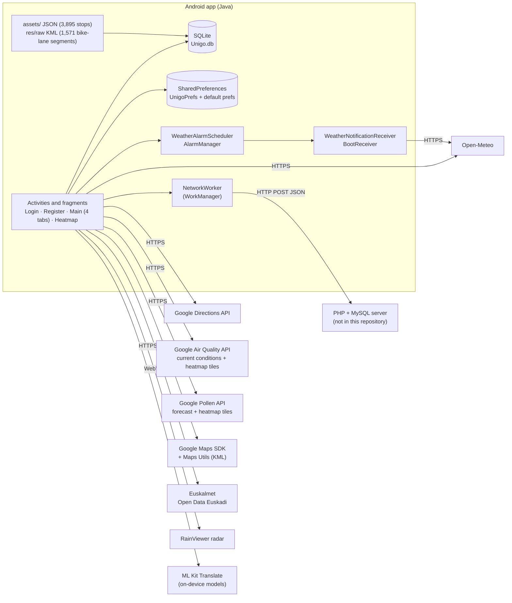
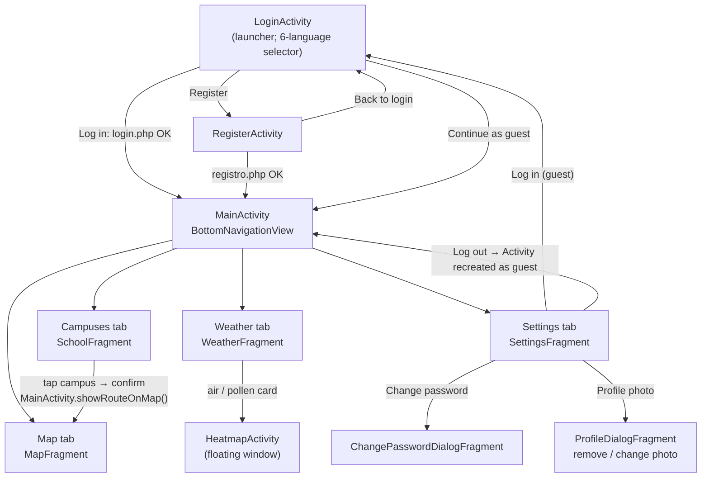
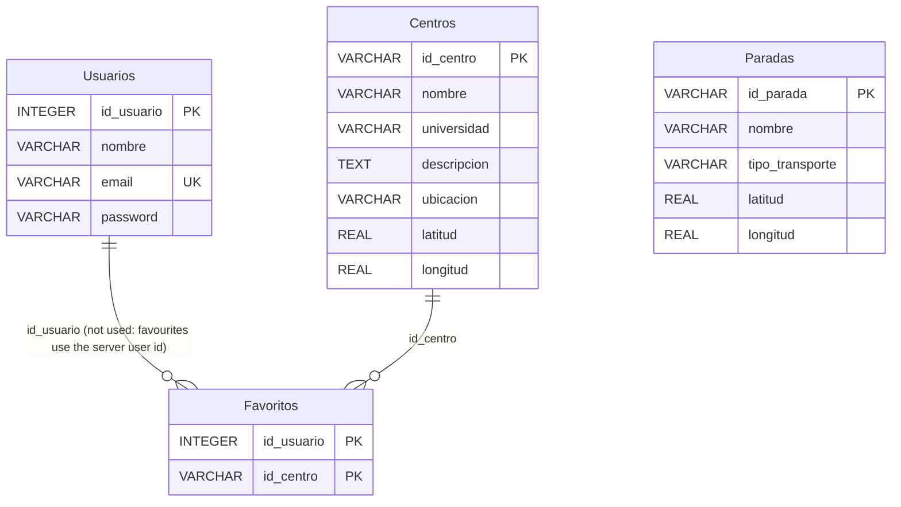
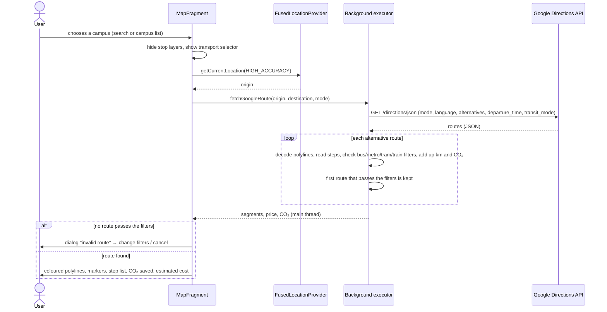
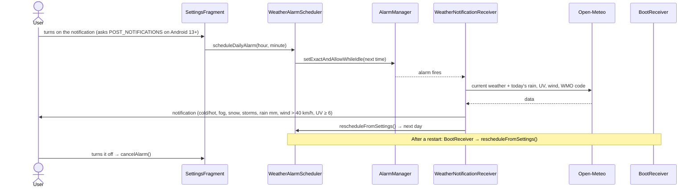

# UNIGO — Design document

This document describes how the app is built. Everything in it was taken from the source code of this repository. No written project report was available, so this is not a translation of one.

Class and resource names are the English names used since version 1.1.0. [Appendix A](#appendix-a--name-equivalence-table) maps them to the original Spanish names.

## Contents

1. [Purpose](#1-purpose)
2. [Architecture](#2-architecture)
3. [Screens and navigation](#3-screens-and-navigation)
4. [Components](#4-components)
5. [Data model](#5-data-model)
6. [Route calculation and CO₂ estimate](#6-route-calculation-and-co-estimate)
7. [Weather and daily notification](#7-weather-and-daily-notification)
8. [Back-end API (PHP server)](#8-back-end-api-php-server)
9. [Localisation and per-user settings](#9-localisation-and-per-user-settings)
10. [Security notes](#10-security-notes)
- [Appendix A — Name equivalence table](#appendix-a--name-equivalence-table)

---

## 1. Purpose

UNIGO helps university students in Bilbao and Bizkaia get to their campus. In one app it combines:
- a map with routes to 28 campuses of UPV/EHU (17), Mondragon Unibertsitatea (4) and the University of Deusto (7);
- the stops of 7 public transport networks and the city's bike lanes;
- weather, air quality and pollen information;
- personal settings and favourites for registered users.

Users can also enter as **guests**: everything works except the account functions (profile photo, password change, settings and favourites saved per account).

## 2. Architecture

- **Single main Activity with fragments.** `MainActivity` holds four fragments behind a `BottomNavigationView`. It shows and hides them instead of replacing them, so each tab keeps its state.
- **Local data.** Campuses and stops live in SQLite. Settings, the session and favourites are stored per user (see [section 9](#9-localisation-and-per-user-settings)).
- **Network.**
  - The calls to the app's own server go through a `Worker` (WorkManager), observed with `LiveData`.
  - The calls to the Google and Open-Meteo APIs use Volley or `HttpURLConnection` on a background executor.

## 3. Screens and navigation

| Screen | What the user can do |
|---|---|
| Map | Search for a campus; choose walking, bike or public transport; filter by bus / metro / tram / train and departure date and time; see the steps, the price (if Google returns it) and the CO₂ saved; show the stops of one network or the bike lanes. |
| Campuses | List of the 28 campuses with logo, area and photo; filter by university; search by name, description or university; star favourites (they move to the top); open the route on the map. |
| Weather | Current weather and icon (Open-Meteo); Euskalmet forecast for Greater Bilbao, translated with ML Kit if the app is not in Spanish or Basque; air quality; pollen; maximum UV; sunrise and sunset; rain radar; temperature at each favourite campus. |
| Settings | Profile photo, account data, password change, log in or out, language, dark mode, favourite transport, electric car, daily notification and its time, map style, data sources. |

## 4. Components

| Package | Class | Responsibility |
|---|---|---|
| `com.example.unigo_das` | `UnigoApplication` | Applies the saved light/dark theme of the current user at start-up. |
| `activities` | `LoginActivity` | Login against `login.php`; guest mode; language selector; restores the user's language and theme. |
| | `RegisterActivity` | Registration against `registro.php`, then opens the main screen with a cleared back stack. |
| | `MainActivity` | Tabs, status-bar colour, route requests from the campus list, and loading campuses and stops into SQLite. |
| | `HeatmapActivity` | Map with Google Air Quality or Pollen heatmap tiles (`UrlTileProvider`). |
| `fragments` | `MapFragment` | Map, campus search, Directions requests, route filters and drawing, CO₂ and price card, stop and bike-lane layers. |
| | `SchoolFragment` + `adapters/CampusAdapter` | Campus list (RecyclerView) with filters, search, favourites and expandable photo. |
| | `WeatherFragment` | All weather cards (Volley requests, XML parsing, ML Kit translation, RainViewer WebView). |
| | `SettingsFragment` | `PreferenceFragmentCompat` with all the settings, profile photo upload (multipart) and alarm scheduling. |
| | `ProfileHeaderPreference` | Custom preference that shows the profile photo downloaded from the server. |
| | `ProfileDialogFragment`, `ChangePasswordDialogFragment` | Dialogs for the photo and the password (`cambiar_password.php`). |
| | `LanguageDialogFragment`, `AccountDetailFragment` | Not used by the current screens (only the `LanguageChangeListener` interface is used). |
| `db` | `DataBaseHelper` | `SQLiteOpenHelper`: schema, campuses, favourites, stops. |
| `item` | `Campus`, `TransitStop` | Data classes. |
| `network` | `NetworkWorker` | Generic POST of the WorkManager input data as JSON to `http://35.233.9.137/<script>`. |
| `receivers` | `WeatherNotificationReceiver` | Builds the daily notification from the Open-Meteo forecast for Bilbao (temperature, WMO code, rain, wind, UV). |
| | `WeatherAlarmScheduler`, `BootReceiver` | Schedule the daily alarm and restore it after a restart (added in 1.1.0, fix F2). |

## 5. Data model

### SQLite (`Unigo.db`, schema version 3)

- **Centros** (campuses) is rewritten on every start with `insert … ON CONFLICT IGNORE` followed by `UPDATE`. This way the campus names follow the current language (they come from `strings.xml`). The descriptions are short Spanish placeholders.
- **Paradas** (stops) is filled once, in a background thread, from the 7 JSON files in `assets/`:

  | File | Network | Stops |
  |---|---|---:|
  | `paradas_bizkaibus.json` | Bizkaibus | 2,336 |
  | `paradas_euskotren.json` | Euskotren | 674 |
  | `paradas_bilbobus.json` | Bilbobus | 532 |
  | `paradas_metro.json` | Metro Bilbao | 191 |
  | `paradas_renfe.json` | Renfe | 98 |
  | `paradas_bici.json` | Bilbaobizi (bikes) | 48 |
  | `paradas_tranvia.json` | Tram | 16 |
  | | **Total** | **3,895** |

- **Favoritos** (favourites) uses the user id returned by the server (`user_id` in SharedPreferences, 0 for guests). Foreign keys are not enforced (`PRAGMA foreign_keys` is off).
- **Usuarios** (users) is created but not used: the login is done by the server.
- The bike lanes are not in SQLite: `res/raw/bike_lanes.kml` (1,571 placemarks) is drawn with the Maps Utils `KmlLayer`.

## 6. Route calculation and CO₂ estimate

The CO₂ estimate is coded in `MapFragment.fetchGoogleRoute()`:

| Item | Formula in the code |
|---|---|
| Bus step | `km × 80` g CO₂ |
| Other public transport step (metro, tram, train) | `km × 40` g CO₂ |
| Walking or bike | 0 g |
| Car used for comparison | `straight-line km × 1.3 × 143` g CO₂, or 0 if the "electric car" option is on |
| Saving shown | `max(0, car CO₂ − route CO₂)` |

Other details:
- Light line colours (luminance > 0.75) are replaced by dark grey in light mode, so that they stay readable.
- Walking steps are drawn as dotted lines.

## 7. Weather and daily notification

| Card | Source | Notes |
|---|---|---|
| Temperature, weather icon, max UV, sunrise and sunset | Open-Meteo `forecast` | WMO codes are translated into 21 descriptions. |
| Greater Bilbao forecast | Euskalmet XML (Open Data Euskadi), `areaId = 8`, today | Spanish or Basque text; other languages are translated on the device with ML Kit. |
| Air quality | Google Air Quality `currentConditions:lookup` (POST) | Category mapped to 7 translated levels (plus "unknown"). |
| Pollen | Google Pollen `forecast:lookup` | The highest category of all pollen types is shown. |
| Heat maps | Google Air Quality / Pollen heatmap tiles | Opened in `HeatmapActivity`. |
| Rain radar | RainViewer page in a `WebView` | Links that leave the radar page are blocked. |

## 8. Back-end API (PHP server)

The server code is not in this repository. The app calls these scripts at `http://35.233.9.137/`:

| Script | Sent by | Request | Response fields used |
|---|---|---|---|
| `login.php` | `LoginActivity` | JSON `email`, `password` | `success`, `nombre`, `id`, `foto`, `error` |
| `registro.php` | `RegisterActivity` | JSON `username`, `email`, `password` | `success`, `id`, `error` |
| `cambiar_password.php` | `ChangePasswordDialogFragment` | JSON `email`, `old_password`, `new_password` | `success`, `error` |
| `subir_foto.php` | `SettingsFragment` | multipart `email`, `foto` (JPEG, quality 80) | `success`, `foto_url` |
| `eliminar_foto.php` | `SettingsFragment` | JSON `email` | (not read) |

## 9. Localisation and per-user settings

- **6 languages:** Spanish (default), Basque, English, French, German and Italian, with 267 strings each. The app language is changed with `AppCompatDelegate.setApplicationLocales()`. Android 13+ stores it per app; for older versions, `AppLocalesMetadataHolderService` keeps it.
- **Per-user settings.** For a logged-in user, each setting is saved in `UnigoPrefs` with the email as suffix. The keys are: `dark_mode_<email>`, `language_<email>`, `tipo_mapa_<email>`, `transporte_favorito_<email>`, `pref_coche_electrico_<email>`, `pref_notificaciones_<email>` and `profile_photo_url_<email>`. Guests use the default SharedPreferences. Several people can therefore use the app on the same phone and keep their own theme, language and settings.

## 10. Security notes

| Topic | Current state |
|---|---|
| API keys | Read from `secrets.properties`, which is not in Git since 1.1.0, through the Secrets Gradle Plugin. Placeholder values are in `secrets.defaults.properties`. The key that was committed before must be revoked. |
| Transport | The app's server is called over plain HTTP (`usesCleartextTraffic=true`). Passwords are therefore sent unencrypted; HTTPS on the server is needed. |
| Authentication of later requests | Photo upload and deletion only send the email; there is no session token. |
| Local data | No passwords are stored locally (the `Usuarios` table is not used). The session data lives in private SharedPreferences. |

---

## Appendix A — Name equivalence table

Every original name was replaced by the same new name in all its uses. Persisted keys, SQLite names, JSON fields and server parameters keep their original Spanish names (they are string literals).

### A.1 Java (342 names)

| Original | New | Kind | Where (original file) |
|---|---|---|---|
| `abrirGaleria` | `openGallery` | method | ProfileDialogFragment |
| `abrirPantallaMapaCalor` | `openHeatmapScreen` | method | WeatherFragment |
| `activado` | `notificationsEnabled` | local variable | SettingsFragment |
| `activarUbicacionEnMapa` | `enableMyLocationOnMap` | method | MapFragment |
| `activo` | `activeButton` | parameter | LoginActivity, RegisterActivity |
| `actual` | `currentTransport` | local variable | SettingsFragment |
| `actualizarBotonActivo` | `updateActiveButton` | method | SchoolFragment |
| `actualizarClimaConNombre` | `updateWeatherWithName` | method | WeatherFragment |
| `actualizarListaCompleta` | `updateFullList` | method | CentroAdapter |
| `actualizarSummaryIdioma` | `updateLanguageSummary` | method | SettingsFragment |
| `actualizarTarjetaUV` | `updateUvCard` | method | WeatherFragment |
| `actualizarTextoPolen` | `updatePollenText` | method | WeatherFragment |
| `actualMapa` | `currentMapType` | local variable | SettingsFragment |
| `agencia` | `agency` | local variable | MapFragment |
| `ahorroCO2Definitivo` | `finalCo2Saving` | local variable | MapFragment |
| `alternarEstadoTarjeta` | `toggleCardState` | method | MapFragment |
| `amanecer` | `sunrise` | local variable | WeatherFragment |
| `amanecerIso` | `sunriseIso` | local variable | WeatherFragment |
| `anadirFavorito` | `addFavorite` | method | DataBaseHelper |
| `anochecer` | `sunset` | local variable | WeatherFragment |
| `anochecerIso` | `sunsetIso` | local variable | WeatherFragment |
| `aplicarFiltrosCombinados` | `applyCombinedFilters` | method | SchoolFragment |
| `aplicarModoOscuro` | `applyDarkMode` | method | MainActivity |
| `aplicarTemaGuardado` | `applySavedTheme` | method | UnigoApplication |
| `aplicarTemaUsuario` | `applyUserTheme` | method | LoginActivity |
| `archivosAssets` | `assetFiles` | local variable | MainActivity |
| `argumentos` | `queryArgs` | local variable | DataBaseHelper |
| `asignarIconoYTexto` | `setIconAndText` | method | WeatherFragment |
| `bd` | `database` | local variable | DataBaseHelper |
| `borrarFavorito` | `removeFavorite` | method | DataBaseHelper |
| `btnActivo` | `btnActive` | parameter | SchoolFragment |
| `btnCerrarBusqueda` | `btnCloseSearch` | field | MapFragment |
| `btnFecha` | `btnDate` | local variable | MapFragment |
| `btnFiltroDeusto` | `btnFilterDeusto` | field | SchoolFragment |
| `btnFiltroEHU` | `btnFilterEhu` | field | SchoolFragment |
| `btnFiltroMondragon` | `btnFilterMondragon` | field | SchoolFragment |
| `btnFiltrosTransporte` | `btnTransitFilters` | field | MapFragment |
| `btnFiltroTodas` | `btnFilterAll` | field | SchoolFragment |
| `btnHora` | `btnTime` | local variable | MapFragment |
| `btnMinimizarRuta` | `btnMinimizeRoute` | field | MapFragment |
| `btnQuitarRuta` | `btnClearRoute` | field | MapFragment |
| `BuscadorMapaAdapter` | `MapSearchAdapter` | class, method | MapFragment |
| `busquedaActual` | `currentSearch` | field | SchoolFragment |
| `calendario` | `calendar` | local variable | SettingsFragment |
| `cambiarContrasena` | `requestPasswordChange` | method | ChangePasswordDialogFragment |
| `cambiarIdiomaLogin` | `changeLoginLanguage` | method | LoginActivity, RegisterActivity |
| `cancelarAlarma` | `cancelAlarm` | method | SettingsFragment |
| `capaBidegorris` | `bikeLaneLayer` | field | MapFragment |
| `capaClickBuscador` | `searchClickLayer` | local variable | MapFragment |
| `capaSeleccionadaIndex` | `selectedLayerIndex` | field | MapFragment |
| `cardBuscadorFalso` | `cardFakeSearchBar` | field | MapFragment |
| `cardInfoRutas` | `cardRouteInfo` | field | MapFragment |
| `cardTransporte` | `cardTransport` | field | MapFragment |
| `cargarAjustesMapa` | `loadMapSettings` | method | MapFragment |
| `cargarClimaFavoritos` | `loadFavoritesWeather` | method | WeatherFragment |
| `cargarDatosBuscador` | `loadSearchData` | method | MapFragment |
| `cargarDatosDesdeBD` | `loadDataFromDb` | method | SchoolFragment |
| `cargarImagenDesdeUrl` | `loadImageFromUrl` | method | ProfileHeaderPreference |
| `cargarRadarRainViewer` | `loadRainViewerRadar` | method | WeatherFragment |
| `categoriaEn` | `categoryEn` | parameter | WeatherFragment |
| `categoriaIngles` | `categoryEnglish` | local variable | WeatherFragment |
| `categoriaTraducida` | `translatedCategory` | local variable | WeatherFragment |
| `cbCocheElec` | `cbElectricCar` | local variable | MapFragment |
| `cbTranvia` | `cbTram` | local variable | MapFragment |
| `cbTren` | `cbTrain` | local variable | MapFragment |
| `Centro` | `Campus` | class, method | Centro |
| `centro` | `campus` | local variable, parameter | CentroAdapter, DataBaseHelper, SchoolFragment, WeatherFragment |
| `CentroAdapter` | `CampusAdapter` | class, method | CentroAdapter |
| `centroBizkaia` | `bizkaiaCenter` | local variable | MapFragment |
| `centroList` | `campusList` | field, parameter | CentroAdapter |
| `centroListFull` | `campusListFull` | field | CentroAdapter |
| `centroSeleccionado` | `selectedCampus` | local variable | MapFragment |
| `centrosEstaVacia` | `isCampusTableEmpty` | method | DataBaseHelper |
| `CentroViewHolder` | `CampusViewHolder` | class, method | CentroAdapter |
| `cerrarPantallaBusqueda` | `closeSearchScreen` | method | MapFragment |
| `co2CocheEstimado` | `estimatedCarCo2` | local variable | MapFragment |
| `co2TotalRutaFinal` | `finalRouteCo2` | local variable | MapFragment |
| `co2TotalRutaTemp` | `tempRouteCo2` | local variable | MapFragment |
| `co2Tramo` | `stepCo2` | local variable | MapFragment |
| `cocheElecState` | `electricCarState` | local variable | SettingsFragment |
| `cocheElectricoPref` | `electricCarPref` | local variable | SettingsFragment |
| `cocheEraElectrico` | `carWasElectric` | local variable | MapFragment |
| `codigoClima` | `weatherCode` | local variable | NotificacionClimaReceiver, WeatherFragment |
| `codigos` | `codes` | local variable | SettingsFragment |
| `colorGris` | `greyColor` | local variable | SchoolFragment |
| `colorPinche` | `markerHue` | local variable | MapFragment |
| `colorRojo` | `redColor` | local variable | SchoolFragment |
| `comprobarLogin` | `checkLogin` | method | DataBaseHelper |
| `comprobarPermisosDeUbicacion` | `checkLocationPermissions` | method | MapFragment |
| `contenedor` | `favoritesContainer` | local variable | WeatherFragment |
| `cSel` | `selectedCal` | local variable | MapFragment |
| `cvMapaAire` | `cvAirMap` | local variable | WeatherFragment |
| `cvMapaPolen` | `cvPollenMap` | local variable | WeatherFragment |
| `decodificados` | `decodedPoints` | local variable | MapFragment |
| `decodificarBase64` | `decodeBase64` | method | ProfileHeaderPreference |
| `decodificarPolyline` | `decodePolyline` | method | MapFragment |
| `descripcion` | `description` | field, local variable, parameter | Centro, DataBaseHelper, WeatherFragment |
| `destino` | `destination` | local variable, parameter | MapFragment |
| `destinoActual` | `currentDestination` | field | MapFragment |
| `destinoPendiente` | `pendingDestination` | field | MapFragment |
| `dibujarLineaHastaDestino` | `drawRouteToDestination` | method | MapFragment |
| `direccion` | `headsign` | field | MapFragment |
| `duracion` | `duration` | field | MapFragment |
| `ejecutarLogin` | `performLogin` | method | LoginActivity |
| `ejecutarRegistro` | `performRegistration` | method | RegisterActivity |
| `elBuilder` | `notificationBuilder` | local variable | NotificacionClimaReceiver |
| `elCanal` | `channel` | local variable | NotificacionClimaReceiver |
| `eliminarFotoPerfil` | `deleteProfilePhoto` | method | SettingsFragment |
| `elManager` | `notificationManager` | local variable | NotificacionClimaReceiver |
| `esCaminando` | `isWalking` | field | MapFragment |
| `esColorDemasiadoClaro` | `isColorTooLight` | method | MapFragment |
| `esInvitado` | `isGuestUser` | parameter | LoginActivity |
| `esRutaTotalmenteValida` | `isRouteFullyValid` | local variable | MapFragment |
| `etNombreReg` | `etNameReg` | field | RegisterActivity |
| `fabCapasTransporte` | `fabTransitLayers` | field | MapFragment |
| `favoritos` | `favorites` | local variable | WeatherFragment |
| `filtrados` | `filtered` | local variable | MapFragment |
| `filtroUniversidadActual` | `currentUniversityFilter` | field | SchoolFragment |
| `formatoFecha` | `dateFormat` | local variable | MapFragment |
| `formatoHora` | `timeFormat` | local variable | MapFragment |
| `fotoUrl` | `photoUrl` | local variable | LoginActivity, ProfileHeaderPreference, SettingsFragment |
| `galeriaLauncher` | `galleryLauncher` | field | SettingsFragment |
| `gestor` | `alarmManager` | local variable | SettingsFragment |
| `getDescripcion` | `getDescription` | method | Centro |
| `getLatitud` | `getLatitude` | method | Centro, Parada |
| `getLongitud` | `getLongitude` | method | Centro, Parada |
| `getNombre` | `getName` | method | Centro, Parada |
| `getTipo` | `getType` | method | Parada |
| `getUbicacion` | `getDistrict` | method | Centro |
| `getUniversidad` | `getUniversity` | method | Centro |
| `guardado` | `saved` | local variable | SettingsFragment |
| `guardarFavorito` | `saveFavorite` | method | SchoolFragment |
| `guardarFotoPerfil` | `uploadProfilePhoto` | method | SettingsFragment |
| `headerBusqueda` | `searchHeader` | field | MapFragment |
| `headerRutas` | `routesHeader` | field | MapFragment |
| `hora` | `alarmHour` | parameter | SettingsFragment |
| `horaActual` | `currentTime` | local variable | SettingsFragment |
| `horaAviso` | `alertTime` | local variable | SettingsFragment |
| `horaFormateada` | `formattedTime` | local variable | SettingsFragment |
| `horaLlegada` | `arrivalTime` | field | MapFragment |
| `horaPref` | `timePref` | local variable | SettingsFragment |
| `horaSalida` | `departureTime` | field | MapFragment |
| `id_centro` | `campusId` | parameter | DataBaseHelper |
| `id_usuario` | `userId` | parameter | DataBaseHelper |
| `idCanal` | `channelId` | local variable | NotificacionClimaReceiver |
| `idCentro` | `campusCode` | parameter | CentroAdapter |
| `idioma` | `language` | local variable | WeatherFragment |
| `idiomaActual` | `currentLanguage` | local variable | MapFragment |
| `idiomaDestino` | `targetLanguage` | parameter | WeatherFragment |
| `idiomas` | `languageNames` | local variable | SettingsFragment |
| `idUsuario` | `foundUserId` | local variable | DataBaseHelper |
| `idUsuarioActual` | `currentUserId` | local variable | SchoolFragment, WeatherFragment |
| `inactivos` | `inactiveButtons` | parameter | LoginActivity, RegisterActivity |
| `infoCO2` | `co2Info` | field | MapFragment |
| `infoExtra` | `extraInfo` | local variable | MapFragment |
| `inicializarCampus` | `initializeCampuses` | method | MainActivity |
| `inicializarParadasTransporte` | `initializeTransitStops` | method | MainActivity |
| `iniciarRutaHaciaDestino` | `startRouteToDestination` | method | MapFragment |
| `insertarCentro` | `insertCampus` | method | DataBaseHelper |
| `insertarParadasMasivas` | `insertStopsBulk` | method | DataBaseHelper |
| `insertarUsuario` | `insertUser` | method | DataBaseHelper |
| `irAMainActivity` | `goToMainActivity` | method | LoginActivity, RegisterActivity |
| `irRutaEnMapa` | `showRouteOnMap` | method | MainActivity |
| `isCocheElectrico` | `isElectricCar` | field | MapFragment |
| `isTarjetaExpandida` | `isCardExpanded` | field | MapFragment |
| `ivIcono` | `ivIcon` | parameter | WeatherFragment |
| `ivIconoClimaPrincipal` | `ivMainWeatherIcon` | field | WeatherFragment |
| `ivMapaCentro` | `ivCampusPhoto` | field | CentroAdapter |
| `kmCocheJustos` | `carKm` | local variable | MapFragment |
| `kmLineaRecta` | `straightLineKm` | local variable | MapFragment |
| `kmTotalesFinal` | `finalTotalKm` | local variable | MapFragment |
| `kmTotalesTemp` | `tempTotalKm` | local variable | MapFragment |
| `kmTramo` | `stepKm` | local variable | MapFragment |
| `langActual` | `activeLang` | local variable | SettingsFragment |
| `lanzarNotificacionFinal` | `showFinalNotification` | method | NotificacionClimaReceiver |
| `latDestino` | `destLat` | parameter | MainActivity, MapFragment |
| `latitud` | `latitude` | field, parameter | Centro, DataBaseHelper, Parada, WeatherFragment |
| `layoutFechaHora` | `dateTimeLayout` | local variable | MapFragment |
| `layoutTransporte` | `layoutTransport` | field | CentroAdapter |
| `limpiarMarcadoresParadasLibres` | `clearStopMarkers` | method | MapFragment |
| `limpiarRutaActiva` | `clearActiveRoute` | method | MapFragment |
| `lista` | `list` | local variable, parameter | DataBaseHelper, MapFragment |
| `listaCentros` | `campusItems` | field, local variable | DataBaseHelper, SchoolFragment |
| `listaFavoritos` | `favoriteIds` | local variable | DataBaseHelper |
| `listaFiltrada` | `filteredCampuses` | field, local variable | MapFragment, SchoolFragment |
| `listaOriginal` | `originalList` | field | MapFragment |
| `listaOriginalCompletita` | `fullOriginalList` | field | SchoolFragment |
| `listaParadas` | `stopList` | parameter | DataBaseHelper |
| `listaSegmentosFinal` | `finalSegments` | local variable | MapFragment |
| `listaSegmentosTemp` | `tempSegments` | local variable | MapFragment |
| `listaTodosLosCentros` | `allCampuses` | field | MapFragment |
| `llListaInstrucciones` | `llInstructionList` | field | MapFragment |
| `lluviaTotal` | `totalRain` | local variable | NotificacionClimaReceiver |
| `lngDestino` | `destLng` | parameter | MainActivity, MapFragment |
| `longitud` | `longitude` | field, parameter | Centro, DataBaseHelper, Parada, WeatherFragment |
| `luminosidad` | `luminance` | local variable | MapFragment |
| `mapaPref` | `mapPref` | local variable | SettingsFragment |
| `marcadoresParadasActivos` | `activeStopMarkers` | field | MapFragment |
| `marcarEstadoUsuario` | `saveUserState` | method | LoginActivity, RegisterActivity |
| `marcarIdiomaActivo` | `highlightActiveLanguage` | method | LoginActivity, RegisterActivity |
| `mensaje` | `message` | local variable | NotificacionClimaReceiver |
| `metrosTotales` | `totalMeters` | local variable | MapFragment |
| `metrosTramo` | `stepMeters` | local variable | MapFragment |
| `minuto` | `alarmMinute` | parameter | SettingsFragment |
| `modosPermitidos` | `allowedModes` | local variable | MapFragment |
| `modoTransporte` | `transportMode` | parameter | MapFragment |
| `mostrarConfirmacionEliminar` | `showDeleteConfirmation` | method | ProfileDialogFragment |
| `mostrarConfirmacionFoto` | `showPhotoConfirmation` | method | SettingsFragment |
| `mostrarFiltrosTransporte` | `showTransitFilters` | method | MapFragment |
| `mostrarMenuCapasParadas` | `showStopLayersMenu` | method | MapFragment |
| `navegarA` | `navigateTo` | method | MainActivity |
| `nivelMaximo` | `maxLevel` | local variable | WeatherFragment |
| `nombre` | `name` | field, local variable, parameter | Centro, DataBaseHelper, LoginActivity, MainActivity, Parada, RegisterActivity, WeatherFragment |
| `nombreArchivo` | `fileName` | local variable | MainActivity |
| `nombreCentro` | `campusName` | parameter | MainActivity |
| `nombreCiudad` | `cityName` | local variable | WeatherFragment |
| `nombreLinea` | `lineName` | local variable | MapFragment |
| `nombresMapa` | `mapTypeNames` | local variable | SettingsFragment |
| `nombresTransporte` | `transportNames` | local variable | SettingsFragment |
| `notifActivada` | `notificationsOn` | local variable | SettingsFragment |
| `NotificacionClimaReceiver` | `WeatherNotificationReceiver` | class | NotificacionClimaReceiver |
| `nuevaLista` | `newList` | parameter | CentroAdapter |
| `nuevo` | `row` | local variable | DataBaseHelper |
| `nuevoCodigo` | `newCode` | local variable | SettingsFragment |
| `numParadas` | `numStops` | field | MapFragment |
| `objetoRaiz` | `rootObject` | local variable | MainActivity |
| `obtenerCalidadAire` | `fetchAirQuality` | method | WeatherFragment |
| `obtenerCentroPorId` | `getCampusById` | method | DataBaseHelper |
| `obtenerClimaConCola` | `fetchTemperatureQueued` | method | WeatherFragment |
| `obtenerClimaPorCoordenadas` | `fetchWeatherByCoordinates` | method | WeatherFragment |
| `obtenerColorSurface` | `getSurfaceColor` | method | MapFragment |
| `obtenerColorTextoParaTarjeta` | `getCardTextColor` | method | MapFragment |
| `obtenerColorTextoSecundario` | `getSecondaryTextColor` | method | MapFragment |
| `obtenerDatosClimaYLanzarNotificacion` | `fetchWeatherAndNotify` | method | NotificacionClimaReceiver |
| `obtenerIdsFavoritosUsuario` | `getUserFavoriteIds` | method | DataBaseHelper |
| `obtenerMapaPorCentro` | `getPhotoForCampus` | method | CentroAdapter |
| `obtenerNivelPolen` | `fetchPollenLevel` | method | WeatherFragment |
| `obtenerNombreCiudad` | `getCityName` | method | WeatherFragment |
| `obtenerParadasPorTipo` | `getStopsByType` | method | DataBaseHelper |
| `obtenerPronosticoOpenData` | `fetchOpenDataForecast` | method | WeatherFragment |
| `obtenerRutaRealGoogle` | `fetchGoogleRoute` | method | MapFragment |
| `obtenerTodosLosCentros` | `getAllCampuses` | method | DataBaseHelper |
| `obtenerUbicacionYClima` | `fetchLocationAndWeather` | method | WeatherFragment |
| `opciones` | `layerOptions` | local variable | MapFragment |
| `ordenarLista` | `sortList` | method | SchoolFragment |
| `origen` | `origin` | parameter | MapFragment |
| `pantallaBusquedaCompleta` | `fullSearchScreen` | field | MapFragment |
| `Parada` | `TransitStop` | class, method | Parada |
| `paradaDestino` | `arrivalStop` | field | MapFragment |
| `paradaOrigen` | `departureStop` | field | MapFragment |
| `paradas` | `stops` | local variable | MapFragment |
| `paradasAInsertar` | `stopsToInsert` | local variable | MainActivity |
| `paradasEstaVacia` | `isStopTableEmpty` | method | DataBaseHelper |
| `paramsSep` | `separatorParams` | local variable | MapFragment |
| `pasaFiltroTexto` | `passesTextFilter` | local variable | SchoolFragment |
| `pasaFiltroUni` | `passesUniFilter` | local variable | SchoolFragment |
| `peticion` | `apiRequest` | local variable | NotificacionClimaReceiver, WeatherFragment |
| `pF` | `dateParams` | local variable | MapFragment |
| `pH` | `timeParams` | local variable | MapFragment |
| `precioDefinitivo` | `finalPrice` | local variable | MapFragment |
| `precioTotalFinal` | `finalTotalPrice` | local variable | MapFragment |
| `precioTotalTemp` | `tempTotalPrice` | local variable | MapFragment |
| `procesarError` | `handleError` | method | LoginActivity |
| `procesarRespuestaCambio` | `handlePasswordChangeResponse` | method | ChangePasswordDialogFragment |
| `procesarRespuestaLogin` | `handleLoginResponse` | method | LoginActivity |
| `procesarRespuestaServidor` | `handleServerResponse` | method | RegisterActivity |
| `procesarRutaPendiente` | `processPendingRoute` | method | MapFragment |
| `procesarXmlOpenData` | `parseOpenDataXml` | method | WeatherFragment |
| `programarAlarmaDiaria` | `scheduleDailyAlarm` | method | SettingsFragment |
| `proveedorLocalizacion` | `locationProvider` | local variable | MapFragment |
| `puntoInicio` | `startPoint` | field | MapFragment |
| `puntos` | `points` | field | MapFragment |
| `puntosFinal` | `finalPoints` | local variable | MapFragment |
| `puntosTemp` | `tempPoints` | local variable | MapFragment |
| `redibujarCapaParadas` | `redrawStopLayer` | method | MapFragment |
| `respuestaJson` | `jsonReply` | local variable | SettingsFragment |
| `resultado` | `insertResult` | local variable | DataBaseHelper |
| `resultadosDistancia` | `distanceResults` | local variable | MapFragment |
| `rgModoTransporte` | `rgTransportMode` | local variable | MapFragment |
| `rutaCumpleFiltrosEstrictos` | `routeMatchesFilters` | local variable | MapFragment |
| `rutaValidaEncontrada` | `validRouteFound` | local variable | MapFragment |
| `rvCentros` | `rvCampuses` | field | SchoolFragment |
| `scrollInstrucciones` | `scrollInstructions` | field | MapFragment |
| `segmento` | `segment` | local variable | MapFragment |
| `SegmentoRuta` | `RouteSegment` | class | MapFragment |
| `seleccionado` | `selectedIndex` | local variable | SettingsFragment |
| `separador` | `separator` | local variable | MapFragment |
| `separadorAhorro` | `savingSeparator` | local variable | MapFragment |
| `tarjeta` | `card` | local variable | WeatherFragment |
| `tempActual` | `currentTemp` | local variable | NotificacionClimaReceiver |
| `temperatura` | `temperature` | local variable | WeatherFragment |
| `texto` | `text` | parameter | NotificacionClimaReceiver, WeatherFragment |
| `textoEspanol` | `spanishText` | local variable, parameter | WeatherFragment |
| `textoNativo` | `nativeText` | local variable | WeatherFragment |
| `textoTraducido` | `translatedText` | parameter | WeatherFragment |
| `timestampSalidaPersonalizado` | `customDepartureTimestamp` | field | MapFragment |
| `tipo` | `type` | field, local variable, parameter | DataBaseHelper, MainActivity, Parada |
| `tipoMapa` | `mapType` | field, local variable, parameter | HeatmapActivity, MapFragment, WeatherFragment |
| `tipoMapaStr` | `mapTypeStr` | local variable | MapFragment |
| `tipoParaBaseDeDatos` | `dbType` | local variable | MapFragment |
| `tiposDB` | `dbTypes` | local variable | MapFragment |
| `tipoSeleccionado` | `selectedType` | local variable | MapFragment |
| `titulo` | `title` | local variable, parameter | MapFragment, NotificacionClimaReceiver |
| `tituloDestinoActual` | `currentDestinationTitle` | field | MapFragment |
| `tituloInstruccion` | `instructionTitle` | field | MapFragment |
| `tituloPendiente` | `pendingTitle` | field | MapFragment |
| `traducirCalidadAire` | `translateAirQuality` | method | WeatherFragment |
| `traducirConIA` | `translateWithMlKit` | method | WeatherFragment |
| `traducirPolen` | `translatePollen` | method | WeatherFragment |
| `traductor` | `translator` | local variable | WeatherFragment |
| `transporteFav` | `favoriteTransport` | local variable | MapFragment |
| `transportePref` | `transportPref` | local variable | SettingsFragment |
| `tvAhorroCO2` | `tvCo2Saving` | local variable | MapFragment |
| `tvAmanecer` | `tvSunrise` | local variable | WeatherFragment |
| `tvAnochecer` | `tvSunset` | local variable | WeatherFragment |
| `tvAvisoBarik` | `tvBarikNotice` | local variable | MapFragment |
| `tvDescripcionClima` | `tvWeatherDescription` | field | WeatherFragment |
| `tvIndiceAire` | `tvAirIndex` | local variable | WeatherFragment |
| `tvMedios` | `tvModes` | local variable | MapFragment |
| `tvNombre` | `tvCampusName` | field, local variable | CentroAdapter, WeatherFragment |
| `tvPrecio` | `tvPrice` | local variable | MapFragment |
| `tvPronosticoBilbao` | `tvBilbaoForecast` | field | WeatherFragment |
| `tvTemperaturaPrincipal` | `tvMainTemperature` | field | WeatherFragment |
| `tvTiempo` | `tvTime` | local variable | MapFragment |
| `tvUbicacionPrincipal` | `tvMainLocation` | field | WeatherFragment |
| `tvUniUbi` | `tvUniLocation` | field | CentroAdapter |
| `tvVacio` | `tvEmpty` | local variable | WeatherFragment |
| `tvValorUV` | `tvUvValue` | local variable | WeatherFragment |
| `ubi` | `district` | local variable | DataBaseHelper |
| `ubicacion` | `districtName` | field, parameter | Centro, DataBaseHelper |
| `universidad` | `university` | field, parameter | Centro, DataBaseHelper |
| `urlDestino` | `targetUrl` | local variable | WeatherFragment |
| `usarBus` | `useBus` | field | MapFragment |
| `usarMetro` | `useMetro` | field | MapFragment |
| `usarTranvia` | `useTram` | field | MapFragment |
| `usarTren` | `useTrain` | field | MapFragment |
| `usaVehiculoPublico` | `usesPublicVehicle` | local variable | MapFragment |
| `valorElegido` | `chosenValue` | local variable | SettingsFragment |
| `valoresMapa` | `mapTypeValues` | local variable | SettingsFragment |
| `valoresTransporte` | `transportValues` | local variable | SettingsFragment |
| `vientoMax` | `maxWind` | local variable | NotificacionClimaReceiver |
| `wvRadarLluvia` | `wvRainRadar` | field | WeatherFragment |

Renamed source files:

| Original file | New file |
|---|---|
| `item/Centro.java` | `item/Campus.java` |
| `item/Parada.java` | `item/TransitStop.java` |
| `adapters/CentroAdapter.java` | `adapters/CampusAdapter.java` |
| `receivers/NotificacionClimaReceiver.java` | `receivers/WeatherNotificationReceiver.java` |

### A.2 Strings (`R.string` / `@string`) (175 names)

| Original | New |
|---|---|
| `a_n_no_has_guardado_ning_n_campus_en_favoritos` | `no_favorite_campuses_yet` |
| `abre_la_app_para_consultar_la_previsi_n_detallada_antes_de_salir` | `open_app_for_detailed_forecast` |
| `aceptar` | `accept` |
| `aceptar3` | `accept3` |
| `agradecimientos_a_las_entidades_colaboradoras` | `thanks_to_partner_organizations` |
| `ahora` | `now` |
| `aire` | `air` |
| `alerta_por_tormentas_el_ctricas` | `thunderstorm_alert` |
| `alertas_de_clima` | `weather_alerts` |
| `alertas_y_clima` | `alerts_and_weather` |
| `alto` | `uv_high` |
| `aplicar` | `apply` |
| `atenci_n_riesgo_de_nevadas` | `snow_risk_warning` |
| `autobus` | `bus_option` |
| `aviso_programado_para_las` | `alert_scheduled_for` |
| `avisos_diarios_sobre_el_entorno` | `daily_environment_alerts` |
| `bajo` | `uv_low` |
| `bici` | `bike` |
| `billete_ocasional` | `single_ticket` |
| `calidad_aire` | `air_quality` |
| `cambiar_filtros` | `change_filters` |
| `caminar` | `walk` |
| `cancelar` | `cancel` |
| `cancelar2` | `cancel2` |
| `cancelar3` | `cancel3` |
| `cancelar4` | `cancel4` |
| `cancelar5` | `cancel5` |
| `cancelar6` | `cancel6` |
| `cancelar7` | `cancel7` |
| `cargando` | `loading` |
| `cargando2` | `loading2` |
| `cargando_informaci_n_oficial` | `loading_official_info` |
| `centro_deusto_business` | `campus_deusto_business` |
| `centro_deusto_derecho` | `campus_deusto_law` |
| `centro_deusto_educacion_deporte` | `campus_deusto_education_sport` |
| `centro_deusto_ingenieria` | `campus_deusto_engineering` |
| `centro_deusto_salud` | `campus_deusto_health` |
| `centro_deusto_sociales_comunicacion` | `campus_deusto_social_communication` |
| `centro_deusto_sociales_humanas` | `campus_deusto_social_human_sciences` |
| `centro_ehu_aulas_experiencia` | `campus_ehu_experience_classrooms` |
| `centro_ehu_bellas_artes` | `campus_ehu_fine_arts` |
| `centro_ehu_ciencia_tecnologia` | `campus_ehu_science_technology` |
| `centro_ehu_ciencias_sociales_comunicacion` | `campus_ehu_social_communication_sciences` |
| `centro_ehu_derecho` | `campus_ehu_law` |
| `centro_ehu_economia_empresa` | `campus_ehu_economics_business` |
| `centro_ehu_economia_empresa_elcano` | `campus_ehu_economics_business_elcano` |
| `centro_ehu_educacion_bilbao` | `campus_ehu_education_bilbao` |
| `centro_ehu_ingenieria_bilbao` | `campus_ehu_engineering_bilbao` |
| `centro_ehu_ingenieria_bilbao1` | `campus_ehu_engineering_bilbao1` |
| `centro_ehu_ingenieria_bilbao2` | `campus_ehu_engineering_bilbao2` |
| `centro_ehu_ingenieria_bilbao3` | `campus_ehu_engineering_bilbao3` |
| `centro_ehu_medicina_enfermeria` | `campus_ehu_medicine_nursing` |
| `centro_ehu_unidad_docente_medicina` | `campus_ehu_medical_teaching_unit` |
| `centro_mu_as_humanidades` | `campus_mu_as_humanities` |
| `centro_mu_as_politecnica` | `campus_mu_as_polytechnic` |
| `centro_mu_bbf_empresariales` | `campus_mu_bbf_business` |
| `centro_mu_bbf_leinn` | `campus_mu_bbf_leinn` |
| `cerrar` | `close` |
| `chubascos_de_nieve` | `snow_showers` |
| `chubascos_ligeros` | `light_showers` |
| `chubascos_moderados` | `moderate_showers` |
| `chubascos_violentos` | `violent_showers` |
| `cielo_despejado` | `clear_sky` |
| `cielo_despejado2` | `clear_sky2` |
| `clima_en_bilbao` | `weather_in_bilbao` |
| `clima_en_tus_campus_favoritos` | `weather_at_favorite_campuses` |
| `co2_respecto_combustion` | `co2_vs_combustion_car` |
| `coche_electrico_contaminacion` | `electric_car_emissions` |
| `con_ctate_a_internet_para_ver_el_pron_stico_de_hoy` | `connect_to_see_forecast` |
| `confirmar_foto_de_perfil` | `confirm_profile_photo` |
| `coste_estimado` | `estimated_cost` |
| `coste_estimado_aviso` | `estimated_cost_notice` |
| `creado_por_jon_ander_duque_asier_faraig_y_andoni_ortiz_de_zarate` | `created_by_authors` |
| `d_a_caluroso` | `hot_day` |
| `desconocido` | `unknown` |
| `desde` | `from` |
| `destino_final` | `final_destination` |
| `detectando_ubicaci_n` | `detecting_location` |
| `direccion` | `direction` |
| `eliminar` | `delete` |
| `eliminar_foto` | `delete_photo` |
| `equipo_de_desarrollo` | `development_team` |
| `error_al_procesar_respuesta_del_servidor` | `server_response_parse_error` |
| `error_al_subir_foto` | `photo_upload_error` |
| `error_de_conexi_n` | `connection_error` |
| `error_de_conexi_n_con_el_servidor` | `server_connection_error` |
| `error_de_red_o_credenciales_incorrectas` | `network_or_credentials_error` |
| `error_en_la_conexi_n` | `connection_failed` |
| `est_s_seguro_de_que_quieres_eliminar_tu_foto_de_perfil` | `confirm_delete_photo_message` |
| `esta_aplicaci_n_utiliza_datos_abiertos_proporcionados_por_euskalmet_open_meteo_open_data_euskadi_bizkaibus_euskotren_y_metro_bilbao_geobilbao_agradecemos_su_labor_en_la_apertura_de_datos_para_esta_aplicaci_n` | `data_sources_acknowledgement` |
| `estilo_de_mapa` | `map_style` |
| `estilo_de_mapa2` | `map_style2` |
| `extremo` | `uv_extreme` |
| `fallo_cr_tico_respuesta_vac_a_del_servidor_php_crash` | `empty_server_response_error` |
| `filtros_ruta_titulo` | `route_filters_title` |
| `foto_actualizada` | `photo_updated` |
| `fuentes_de_datos` | `data_sources` |
| `fuentes_de_datos_open_data` | `open_data_sources` |
| `granizo_suave` | `light_hail` |
| `hace_fr_o_abr_gate_bien` | `cold_wrap_up` |
| `has_evitado` | `you_avoided` |
| `hasta` | `to` |
| `hora_del_aviso_diario` | `daily_alert_time` |
| `horas_de_luz` | `daylight_hours` |
| `hoy` | `today` |
| `informaci_n` | `information` |
| `llovizna` | `drizzle` |
| `llovizna_helada` | `freezing_drizzle` |
| `lluvia_fuerte` | `heavy_rain` |
| `lluvia_fuerte_hoy` | `heavy_rain_today` |
| `lluvia_helada` | `freezing_rain` |
| `lluvia_ligera` | `light_rain` |
| `lluvia_moderada` | `moderate_rain` |
| `mayormente_despejado` | `mostly_clear` |
| `medio_de_transporte_por_defecto` | `default_transport_mode` |
| `medios_preferidos` | `preferred_modes` |
| `mi_coche_es_electrico` | `my_car_is_electric` |
| `mm_imprescindible_paraguas` | `mm_umbrella_needed` |
| `moderado` | `uv_moderate` |
| `mostrar_paradas_titulo` | `show_stops_title` |
| `muy_alto` | `uv_very_high` |
| `ndice_uv_maximo` | `max_uv_index` |
| `nevada_fuerte` | `heavy_snow` |
| `niebla_densa` | `dense_fog` |
| `nieve_ligera` | `light_snow` |
| `nieve_moderada` | `moderate_snow` |
| `no_se_esperan_lluvias` | `no_rain_expected` |
| `notificaciones_de_salud_y_clima` | `health_weather_notifications` |
| `ocultar_paradas` | `hide_stops` |
| `ojo_hay_niebla_precauci_n_si_vas_en_coche_o_bici` | `fog_warning` |
| `paradas` | `stops` |
| `parcialmente_nublado` | `partly_cloudy` |
| `polen` | `pollen` |
| `polen2` | `pollen2` |
| `precauci_n_rachas_de_viento_de` | `wind_gusts_warning` |
| `precio_variable` | `variable_price` |
| `priorizar_rutas_con_puntos_de_recarga` | `prioritize_charging_routes` |
| `pron_stico_euskalmet` | `euskalmet_forecast` |
| `protecci_n_solar_necesaria_uv` | `sun_protection_needed_uv` |
| `quieres_abrir_el_mapa_para_ver_c_mo_llegar_a` | `open_map_to_route_question` |
| `radar_de_precipitaciones_en_vivo` | `live_precipitation_radar` |
| `recibir_avisos_diarios_sobre_polen_lluvia_y_uv` | `daily_pollen_rain_uv_alerts` |
| `restablecer` | `reset` |
| `ruta_al_campus` | `route_to_campus` |
| `ruta_no_valida_mensaje` | `invalid_route_message` |
| `ruta_no_valida_titulo` | `invalid_route_title` |
| `rutas_y_transporte` | `routes_and_transport` |
| `s_trazar_ruta` | `yes_draw_route` |
| `salida_dias_max` | `departure_max_days` |
| `se_esperan_algunos_chubascos` | `some_showers_expected` |
| `seccion_clima_de_euskadi` | `basque_weather_section` |
| `seleccionar_idioma` | `choose_language` |
| `subiendo_foto` | `uploading_photo` |
| `tormenta_con_granizo` | `thunderstorm_with_hail` |
| `tormenta_el_ctrica` | `thunderstorm` |
| `totalmente_nublado` | `overcast` |
| `transporte_favorito` | `favorite_transport` |
| `transporte_favorito2` | `favorite_transport2` |
| `tranvia` | `tram_option` |
| `tren` | `train` |
| `tu_ubicaci_n` | `your_location` |
| `tu_ubicaci_n2` | `your_location2` |
| `unigo_clima_del_campus` | `unigo_campus_weather` |
| `unigo_clima_del_campus2` | `unigo_campus_weather2` |
| `veh_culo_el_ctrico` | `electric_vehicle` |
| `ver_mapa` | `view_map` |
| `ver_mapa2` | `view_map2` |
| `versi_n_de_la_aplicaci_n` | `app_version` |
| `visualizaci_n_del_mapa` | `map_display` |
| `xml_a_pie` | `xml_on_foot` |
| `xml_bici` | `xml_bike` |
| `xml_buscar_centro_facultad` | `xml_search_campus_faculty` |
| `xml_detalles_del_trayecto` | `xml_trip_details` |
| `xml_donde_quieres_ir` | `xml_where_to_go` |
| `xml_publico` | `xml_public` |

### A.3 View IDs (`R.id` / `@+id`) (47 names)

| Original | New |
|---|---|
| `btnCerrarMapa` | `btnCloseMap` |
| `btnFiltroDeusto` | `btnFilterDeusto` |
| `btnFiltroEHU` | `btnFilterEhu` |
| `btnFiltroMondragon` | `btnFilterMondragon` |
| `btnFiltroTodas` | `btnFilterAll` |
| `btn_cerrar_busqueda` | `btn_close_search` |
| `btn_filtros_transporte` | `btn_transit_filters` |
| `btn_minimizar_ruta` | `btn_minimize_route` |
| `btn_quitar_ruta` | `btn_clear_route` |
| `capa_click_buscador` | `search_click_layer` |
| `card_buscador_falso` | `card_fake_search_bar` |
| `card_info_rutas` | `card_route_info` |
| `card_transporte` | `card_transport` |
| `cvMapaAire` | `cvAirMap` |
| `cvMapaPolen` | `cvPollenMap` |
| `etNombreReg` | `etNameReg` |
| `fab_capas_transporte` | `fab_transit_layers` |
| `glFavoritosContainer` | `glFavoritesContainer` |
| `header_busqueda` | `search_header` |
| `header_rutas` | `routes_header` |
| `ivIconoClimaPrincipal` | `ivMainWeatherIcon` |
| `ivLogoCentro` | `ivCampusLogo` |
| `ivMapaCentro` | `ivCampusPhoto` |
| `layoutTransporte` | `layoutTransport` |
| `ll_lista_instrucciones` | `ll_instruction_list` |
| `pantalla_busqueda_completa` | `full_search_screen` |
| `rb_andando` | `rb_walking` |
| `rb_bici` | `rb_bike` |
| `rb_transporte_publico` | `rb_public_transport` |
| `rg_modo_transporte` | `rg_transport_mode` |
| `rvCentros` | `rvCampuses` |
| `scroll_instrucciones` | `scroll_instructions` |
| `searchViewCentros` | `searchViewCampuses` |
| `search_view_falso` | `search_view_fake` |
| `tvAmanecer` | `tvSunrise` |
| `tvAnochecer` | `tvSunset` |
| `tvDescripcionClima` | `tvWeatherDescription` |
| `tvIndiceAire` | `tvAirIndex` |
| `tvIndicePolen` | `tvPollenIndex` |
| `tvNombreCampus` | `tvCampusName` |
| `tvNombreCentro` | `tvCampusTitle` |
| `tvPronosticoBilbao` | `tvBilbaoForecast` |
| `tvTemperaturaPrincipal` | `tvMainTemperature` |
| `tvUbicacionPrincipal` | `tvMainLocation` |
| `tvUniUbi` | `tvUniLocation` |
| `tvValorUV` | `tvUvValue` |
| `wvRadarLluvia` | `wvRainRadar` |

### A.4 Drawables (files renamed) (27 names)

| Original | New |
|---|---|
| `foto_as_fabrik` | `photo_as_fabrik` |
| `foto_basurto` | `photo_basurto` |
| `foto_bellas_artes` | `photo_fine_arts` |
| `foto_ciencia_y_tecnologia` | `photo_science_technology` |
| `foto_cruces` | `photo_cruces` |
| `foto_derecho` | `photo_law` |
| `foto_deusto` | `photo_deusto` |
| `foto_educacion` | `photo_education` |
| `foto_elcano` | `photo_elcano` |
| `foto_experiencia` | `photo_experience` |
| `foto_galdakao` | `photo_galdakao` |
| `foto_medicina_y_enfermeria` | `photo_medicine_nursing` |
| `foto_mondragon_empresariales_leinn` | `photo_mondragon_business_leinn` |
| `foto_nautica` | `photo_nautical` |
| `foto_sanma_nuevo` | `photo_sanmames_new` |
| `foto_sanma_viejo` | `photo_sanmames_old` |
| `foto_sarriko` | `photo_sarriko` |
| `foto_sociales_comunicacion` | `photo_social_communication` |
| `ic_clima_lluvia` | `ic_weather_rain` |
| `ic_clima_niebla` | `ic_weather_fog` |
| `ic_clima_nieve` | `ic_weather_snow` |
| `ic_clima_nubes` | `ic_weather_clouds` |
| `ic_clima_sol` | `ic_weather_sun` |
| `ic_clima_tormenta` | `ic_weather_storm` |
| `ic_icono_unigo_final` | `ic_unigo_icon_final` |
| `ic_icono_unigo_final2` | `ic_unigo_icon_final2` |
| `ic_transporte` | `ic_transport` |

### A.5 String arrays (4 names)

| Original | New |
|---|---|
| `nombres_tipo_mapa` | `map_type_names` |
| `nombres_transporte` | `transport_names` |
| `valores_tipo_mapa` | `map_type_values` |
| `valores_transporte` | `transport_values` |

### A.6 Layouts (files renamed) (2 names)

| Original | New |
|---|---|
| `item_centro` | `item_campus` |
| `item_clima_favorito` | `item_favorite_weather` |

### A.7 Styles (1 names)

| Original | New |
|---|---|
| `TemaVentanaFlotante` | `FloatingWindowTheme` |

### A.8 Raw resources (file renamed) (1 names)

| Original | New |
|---|---|
| `bidegorris` | `bike_lanes` |
